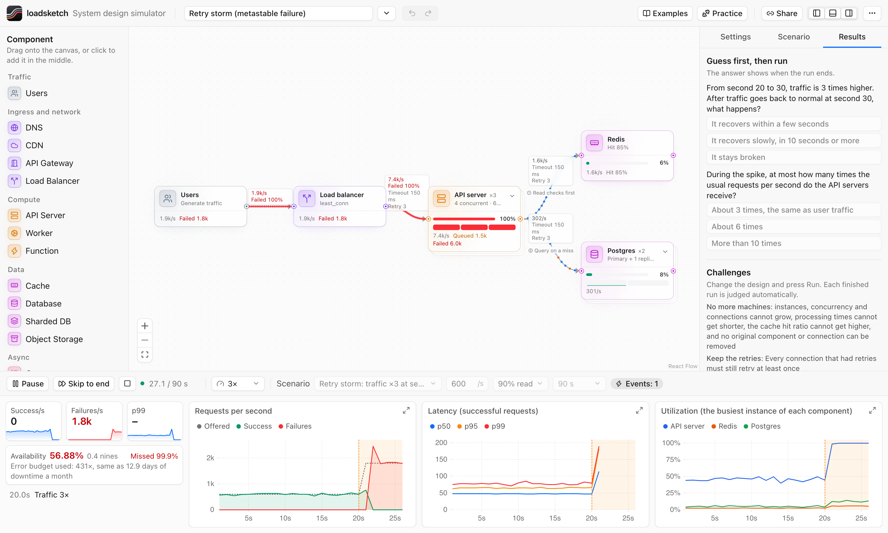
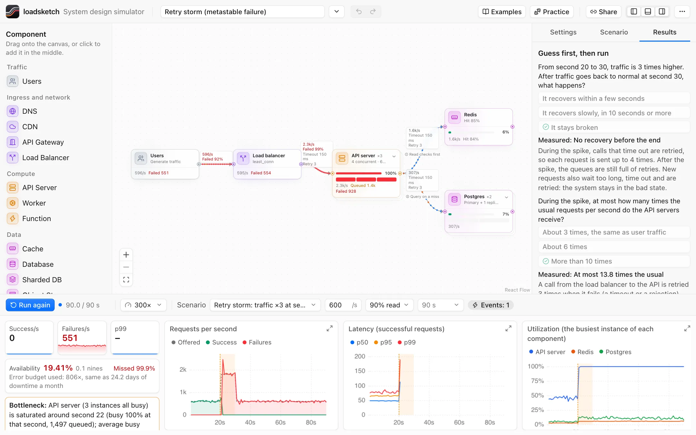
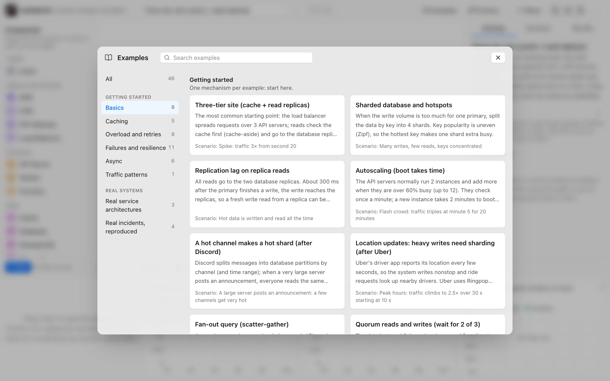
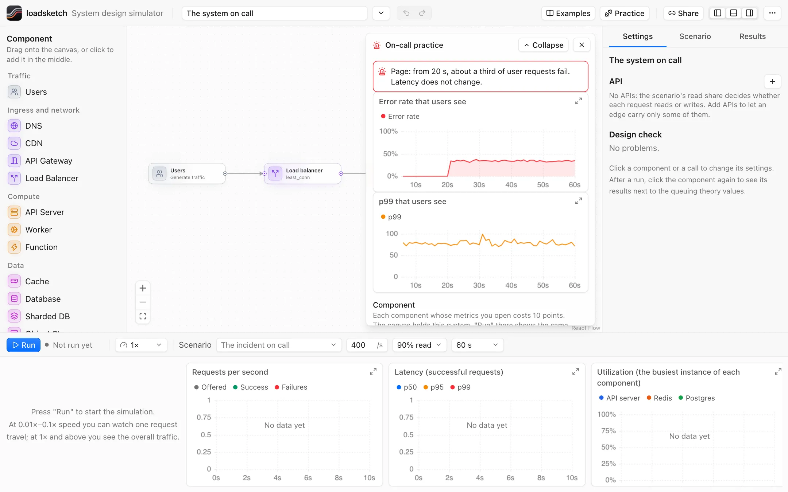
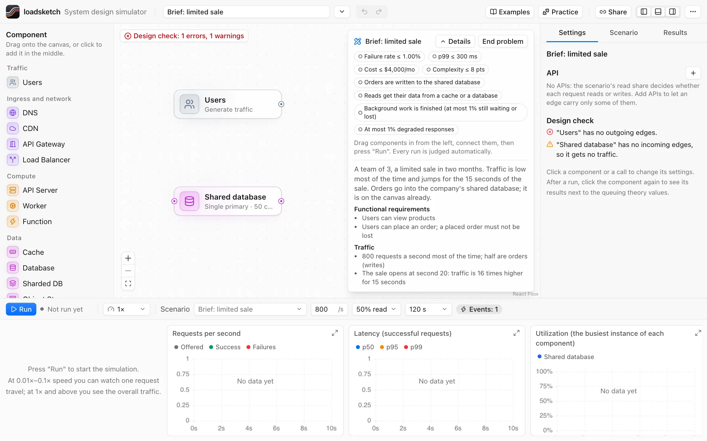
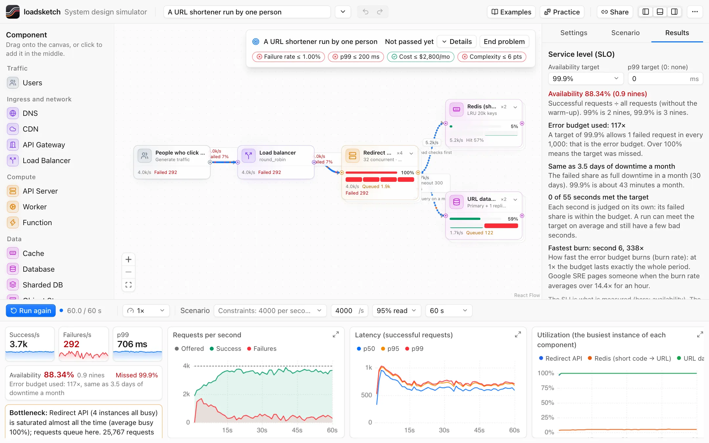
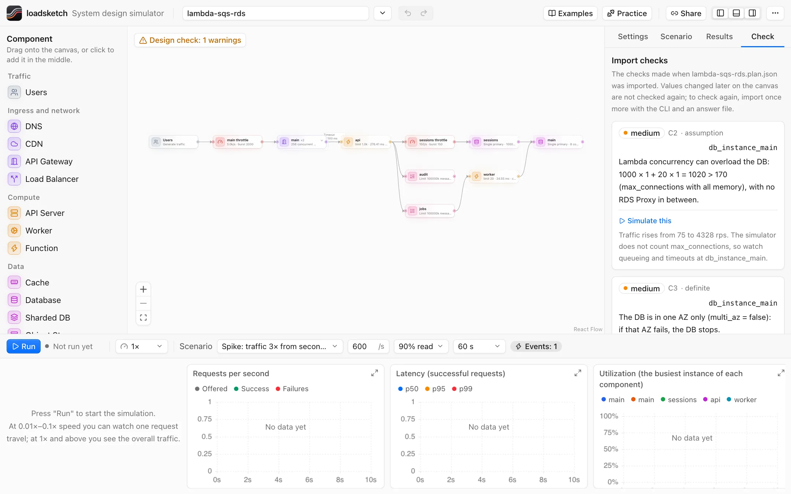

# loadsketch

**Sketch a system. Send traffic. See what breaks first.**

loadsketch is a system design simulator. Put components on a canvas, connect them, send traffic, and see what each design decision does: where requests queue, how latency grows, and what breaks first.

**[Try it in your browser →](https://loadsketch.mclee.dev)** · [繁體中文](README.zh-TW.md)

<picture>
  <source media="(prefers-color-scheme: dark)" srcset="docs/images/screenshot-dark.png">
  
</picture>

## What it does

- **Discrete-event simulation.** Every request goes through every component, with queues, timeouts, retries, circuit breakers and failures. Queueing theory values (M/G/c) are shown next to the simulated results.
- **"Why it happened".** After every run, the simulator tells the story of the run in time order: overload, retries that multiply the load, failures, recovery or a stuck system.
- **16 kinds of component, and every parameter can be changed.** Load balancer, API server, cache, database, queue, CDN and more: instances, concurrency, timeouts, retries, circuit breakers, hit rates.
- **Custom services and presets.** A service that is not in the catalog (search, a payment provider, email) is a custom service: you give its name, icon, service time, capacity, error rate, calls and price per instance. Save any component with its settings as a preset; your presets are in the palette, kept in this browser, and can be exported to a file.
- **47 examples.** Retry storm, cache stampede, gray failure, split brain, a bad config push, poison messages in a FIFO queue, a region cutover, and more. Each one has a scenario and says what to look at.
- **On-call practice (8 incidents).** A fault is hidden. You see only the users' error rate and p99, pay points to open a component's metrics, name the component and the kind of fault, then fix the design on the canvas.
- **Design briefs (6).** Start from requirements and an almost empty canvas: you choose the components and their sizes, then a run shows if the design holds. The brief gives how fast each part is, so a smaller number is not an answer. A reference design is one click away.
- **Constraint problems (3).** Meet error-rate and p99 targets inside a monthly budget and a complexity limit. Every run shows its cost at sample prices.
- **Terraform import.** Turn Terraform plan JSON into a design (ECS, Lambda, RDS, Aurora, SQS, ElastiCache, CloudFront and more). The import checks capacity first, and each finding runs as a scenario.
- **Versions and compare.** Every run keeps a version (the design, the scenario and a summary of the result) in this browser. Pick up to 4 versions to see them side by side: the metrics, and every setting that changed, from what to what. Paired examples open as a comparison with one click, and a share link can carry a comparison.
- **Edit a design with an AI.** "Copy a prompt for an AI" copies a format guide and the current design; paste the answer back. The dialog says in plain words what does not fit the format, lists what changed, and replaces the canvas only after you confirm. The guide is also at [`/llms.txt`](https://loadsketch.mclee.dev/llms.txt). The site itself does not call any AI model.
- **Designs are JSON files.** Designs and scenarios (`loadsketch/design@1`, `loadsketch/scenario@1`) have a JSON Schema in `schema/`. They are easy to read and write for people and AI agents.
- **A CLI.** The engine does not use the browser, so the CLI and the UI run the same engine.
- **Share links with no server.** The design and the scenario are compressed into the part of the URL after `#`, which is never sent to a server.
- **English and Traditional Chinese**, light and dark.

The examples are simplified models. Some refer to public information about well-known services; they are not the real architecture of any company.

## Screenshots

### "Why it happened"

<picture>
  <source media="(prefers-color-scheme: dark)" srcset="src/site/media/why-en-dark.webp">
  
</picture>

### 47 examples

<picture>
  <source media="(prefers-color-scheme: dark)" srcset="src/site/media/examples-en-dark.webp">
  
</picture>

### On-call practice

<picture>
  <source media="(prefers-color-scheme: dark)" srcset="src/site/media/oncall-en-dark.webp">
  
</picture>

### Design briefs

<picture>
  <source media="(prefers-color-scheme: dark)" srcset="src/site/media/brief-en-dark.webp">
  
</picture>

### Constraint problems

<picture>
  <source media="(prefers-color-scheme: dark)" srcset="src/site/media/constraints-en-dark.webp">
  
</picture>

### Terraform import

<picture>
  <source media="(prefers-color-scheme: dark)" srcset="src/site/media/terraform-en-dark.webp">
  
</picture>

## How accurate is it?

It is a model for learning, not a capacity planning tool.

- **What you can trust:** the direction and the mechanism. Which part saturates first, how a slow dependency fills its callers, how retries multiply load, why a system stays down after the spike ends. A comparison of two designs under the same scenario is worth more than one number.
- **What is checked:** single stations are tested against queueing theory. For M/M/1 the mean latency is within 5% and the p99 within 10%; M/M/4 and M/D/1 waits are within 10% (`tests/queueing.test.ts`). Every run is deterministic for a seed, and two designs see the same traffic.
- **What it leaves out:** packets and bandwidth, memory and CPU cores, the contents of the data (it counts stale reads and lost writes, but cannot tell you if your data is correct), and the specific behaviour of real products. A "database" here is a generic database, not PostgreSQL.
- **Do not** size a production system from an absolute number in a run. Measure the real system.

The assumptions are written down in [docs/model.en.md](docs/model.en.md) (summary) and [docs/model.md](docs/model.md) (full, Chinese). If a run does not agree with a real system, a formula or a paper, please [open an issue](https://github.com/minchenlee/loadsketch/issues/new?template=sim-vs-real.yml). I do not know how far the model is from production systems, and reports are how it gets better.

## Run it locally

Requirements: Node.js 22.18 or later.

```sh
git clone https://github.com/minchenlee/loadsketch.git
cd loadsketch
npm install
npm run dev        # the simulator: http://127.0.0.1:5317/app/   the intro site: http://127.0.0.1:5317/
```

## CLI

```sh
node cli/loadsketch.ts run examples/designs/three-tier.json --scenario examples/scenarios/spike.json --lang en
node cli/loadsketch.ts run examples/designs/three-tier.json --rps 2000 --json     # the result as JSON
node cli/loadsketch.ts validate examples/designs/*.json
node cli/loadsketch.ts fmt examples/designs/three-tier.json --check
node cli/loadsketch.ts import terraform tests/import/fixtures/ecs-rds.plan.json --out design.json
```

The CLI prints Chinese by default; use `--lang en` or `LOADSKETCH_LANG=en` for English.

## Using the simulator

- Drag a component from the left onto the canvas. Drag from the point on the right of a card to the left of another card to connect them.
- Click a component or a connection to change its parameters on the right.
- Pick a scenario and a speed at the bottom, then press **Run**. The dots on a connection are requests: blue is a read, orange is a write, red is a failure. At 1× speed or slower you see single requests.
- **Skip to end** computes the whole run at once.
- To keep a component with its settings, select it and press **Save as preset** at the top of the right panel. It appears under **My presets** in the palette.
- **Versions** (right panel) lists your runs. To change a design with an AI, use **Paste design JSON** in the file menu.
- Panels: `⌘B` left, `⌥⌘B` right, `⌘J` bottom (Ctrl on Windows and Linux).
- URL options: `?example=three-tier&scenario=spike&speed=0.1&autorun=1&theme=dark&lang=en`.

## Tests

```sh
npm run test:quick     # about 10 s: fast unit tests and the i18n check
npm run test:slow      # slow unit tests, including the golden test
npm run e2e            # UI tests in headless Chromium
npm run build          # type check, then bundle to dist/
```

## Project layout

| Path | What it holds |
|---|---|
| `src/schema/` | The file formats (zod), the component kinds, the design checks |
| `src/engine/` | The discrete-event simulation. No browser APIs |
| `src/learn/` | Lessons, on-call incidents, design briefs, constraint problems, cost, diagnosis |
| `src/import/terraform/` | Terraform plan JSON → design |
| `src/app/` | The simulator UI (React, React Flow). The simulation runs in a Web Worker |
| `src/site/` | The intro site. Its live panels are the simulator in an iframe (`?embed=1`) |
| `cli/` | The command line |
| `examples/` | Designs and scenarios (JSON) |
| `docs/model.md` | How the model works and what it assumes (Chinese) |
| `docs/model.en.md` | The same, as an English summary |
| `docs/design-system.md` | The look and motion rules of the UI (Chinese) |

`AGENTS.md` has the rules for changing the code, for people and for coding agents.

## Design

The UI follows [kumo](https://github.com/cloudflare/kumo), Cloudflare's open-source design system (MIT). The colour tokens and the look of the cards, buttons, inputs, badges and menus come from kumo; the components are written in this repository and do not use the kumo package. The mapping is at the top of `src/app/index.css`, and the rules are in [docs/design-system.md](docs/design-system.md).

The site runs on Cloudflare Workers static assets (`npm run deploy`).

## Contributing

See [CONTRIBUTING.md](CONTRIBUTING.md).

## License

[MIT](LICENSE)
