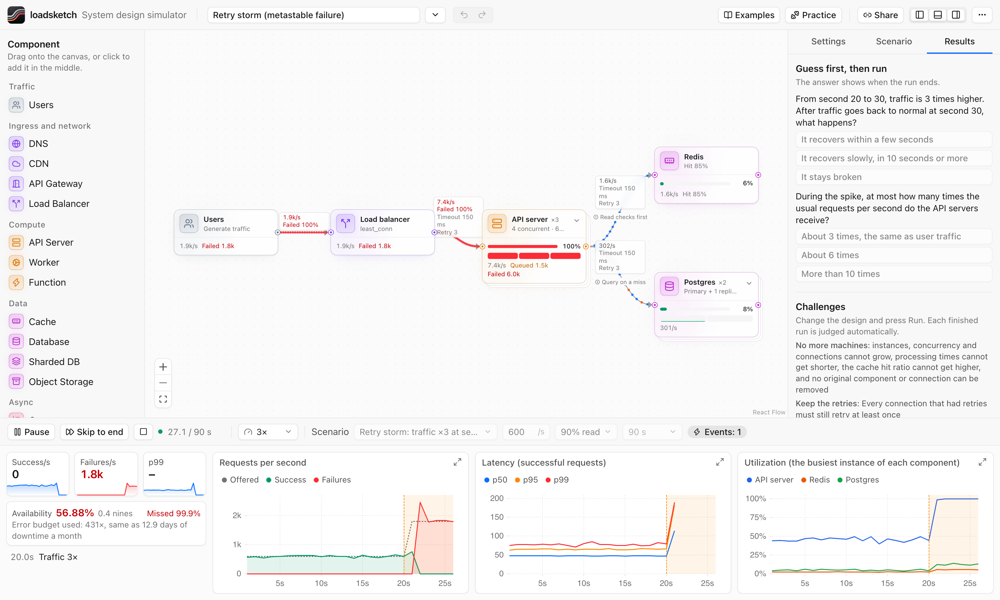
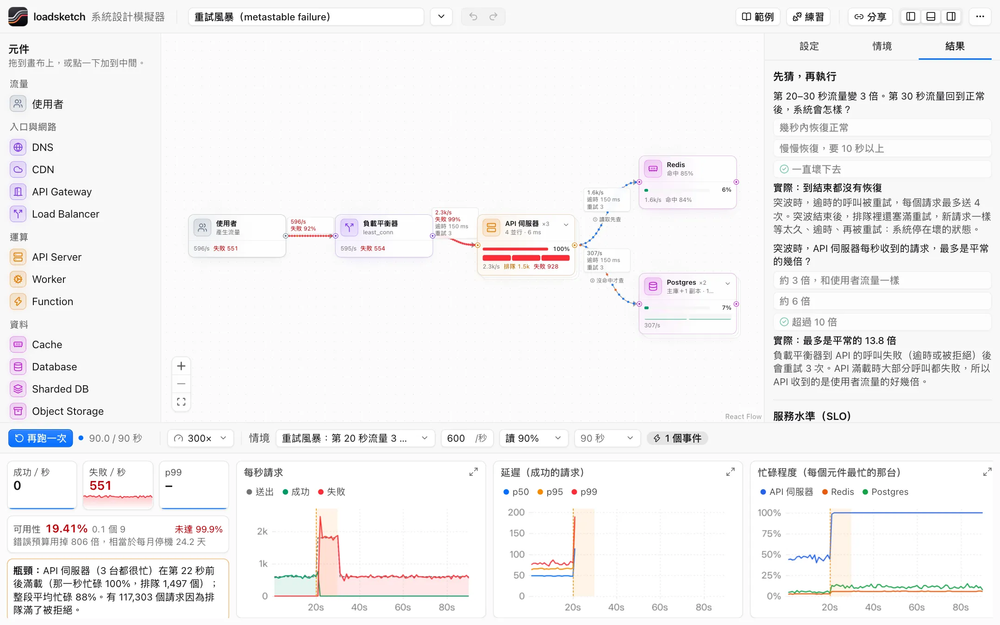
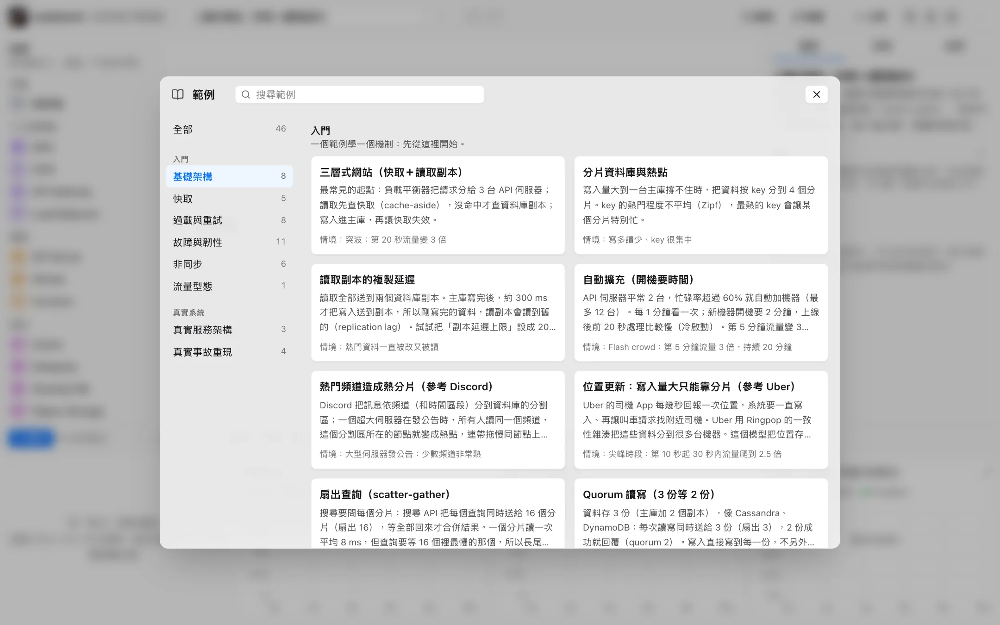
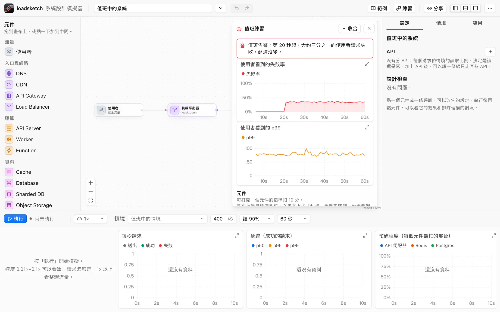
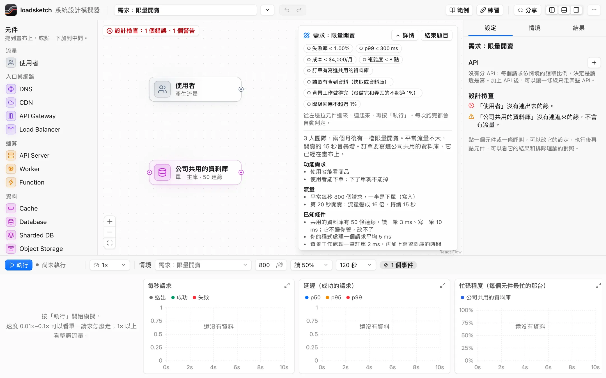
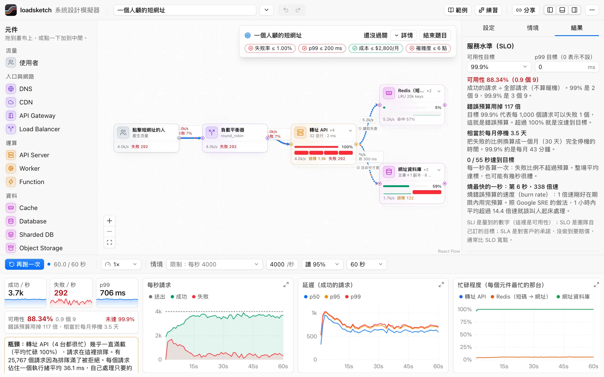
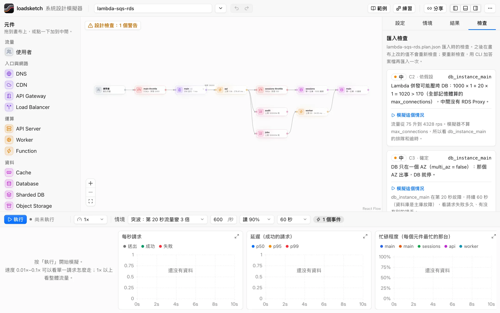

# loadsketch

[English](README.md) · **[在瀏覽器試用 →](https://loadsketch.mclee.dev)**

系統設計模擬器，學習用。把元件拉進來、接起來、灌流量，看每個設計決定的後果：哪裡排隊、延遲怎麼漲、哪裡先壞。

<picture>
  <source media="(prefers-color-scheme: dark)" srcset="docs/images/screenshot-dark.png">
  
</picture>

- 逐筆模擬（discrete-event）：每個請求真的走過每個元件，有排隊、逾時、重試、保險絲、故障。
- 16 種元件（負載平衡器、API 伺服器、快取、資料庫、佇列、CDN 等），每個參數都能調：台數、並行數、逾時、重試、保險絲、命中率。
- 自訂服務：目錄裡沒有的服務（搜尋、金流商、寄信），自己填名稱、圖示、處理時間、容量、錯誤率、呼叫方式和每台價格。任何元件連同設定都能存成樣板，放在元件列的「我的樣板」，存在這個瀏覽器裡，也能匯出成檔案。
- 版本和比較：每次執行會在這個瀏覽器留一個版本（設計、情境、結果摘要）。選最多 4 個版本並排，看指標差多少、哪個設定從什麼改成什麼。成對的範例一鍵就能比較，分享連結也能帶一組比較。
- 讓 AI 改設計：「複製給 AI 的提示」會複製格式說明和目前的設計；把 AI 的回答貼回來，對話框用白話說哪裡不合格式、列出改了什麼，按確認才換掉畫布。格式說明也在 [`/llms-full.txt`](https://loadsketch.mclee.dev/llms-full.txt)；[`/llms.txt`](https://loadsketch.mclee.dev/llms.txt) 是這幾頁的短索引。網站本身不呼叫任何 AI 模型。
- 旁邊附排隊理論的值（M/G/c），可以對照模擬結果。
- 設計和情境都是 JSON 檔（`loadsketch/design@1`、`loadsketch/scenario@1`），人和 agent 都能讀寫。JSON Schema 在 `schema/`。

## 畫面

```sh
npm install
npm run dev        # 模擬器：http://127.0.0.1:5317/app/　介紹頁：http://127.0.0.1:5317/
```

- 左邊拖元件到畫布，從元件右側的點拉線到另一個元件的左側。
- 點元件或連線，在右邊改參數。
- 下方選情境、速度，按「執行」。連線上的小點是流量（藍＝讀、橘＝寫、紅＝失敗）。速度 1× 以下會看到單一請求的圓點走過整條路徑。
- 「跳到結尾」直接算完，右側會說明瓶頸，並和排隊理論對照。
- 要留下一個元件和它的設定：選它，按右側面板上方的「存成樣板」。它會出現在元件列的「我的樣板」。
- 右側的「版本」分頁列出每次執行。要讓 AI 改設計，用檔案選單的「貼上設計 JSON」。
- 學習：每次跑完，右側「為什麼會這樣」照時間說明發生了什麼（滿載、重試放大流量、開始失敗、恢復或卡住）。「重試風暴」範例還有「先猜，再執行」的問題和三個挑戰（不能加機器），每次跑完自動判定，過關的會記在瀏覽器裡。「值班練習」（8 題）：系統裡偷偷放一個故障，只看得到使用者的失敗率和 p99，花點數才能打開元件的指標；找出哪個元件、哪種故障，再到畫布上修好加分。「限制條件題目」（3 題）：在每月預算和複雜度點數（人少、期限短）裡達到失敗率和 p99 的目標，越便宜分數越高。每次跑完都會用示意價格算出每月成本。「從需求開始設計」（6 題）：只有需求和幾乎空白的畫布，自己決定要哪些元件、開多大，跑一次看撐不撐得住；每個零件多快是題目給的，不能靠改小數字過關；可以看參考設計（看了不計分）。
- 隱藏面板：`⌘B` 左邊（元件）、`⌥⌘B` 右邊（設定）、`⌘J` 下方（指標）。Windows／Linux 用 Ctrl 代替 ⌘。右上角也有三個按鈕；設定會記住。
- 語言：依瀏覽器語言顯示中文或英文；右上角「更多」選單可以切換，網址加 `?lang=en` 或 `?lang=zh-TW` 也可以。CLI 用 `--lang en`。
- 網址參數：`?example=three-tier&scenario=spike&speed=0.1&autorun=1&theme=dark&select=api`。
- 分享連結：頂列的「分享」把設計和情境壓縮放進網址 `#s=1.…` 後面，複製到剪貼簿。打開連結就是同一個設計和情境；不需要伺服器，`#` 後面也不會送到伺服器。

## 截圖

### 為什麼會這樣

<picture>
  <source media="(prefers-color-scheme: dark)" srcset="src/site/media/why-zh-dark.webp">
  
</picture>

### 47 個範例

<picture>
  <source media="(prefers-color-scheme: dark)" srcset="src/site/media/examples-zh-dark.webp">
  
</picture>

### 值班練習

<picture>
  <source media="(prefers-color-scheme: dark)" srcset="src/site/media/oncall-zh-dark.webp">
  
</picture>

### 從需求開始設計

<picture>
  <source media="(prefers-color-scheme: dark)" srcset="src/site/media/brief-zh-dark.webp">
  
</picture>

### 限制條件題目

<picture>
  <source media="(prefers-color-scheme: dark)" srcset="src/site/media/constraints-zh-dark.webp">
  
</picture>

### 匯入 Terraform

<picture>
  <source media="(prefers-color-scheme: dark)" srcset="src/site/media/terraform-zh-dark.webp">
  
</picture>

## 準不準？

它是學習用的模型，不是容量規劃工具。

- **可以信的**：方向和機制。哪裡先滿、慢的下游怎麼把上游卡住、重試怎麼把流量放大、為什麼突波過了系統還起不來。同一個情境下比較兩個設計，比看單一數字有用。
- **有驗證的**：單一站和排隊理論對照。M/M/1 的平均延遲差距在 5% 內、p99 在 10% 內；M/M/4 和 M/D/1 的等待時間在 10% 內（`tests/queueing.test.ts`）。同一個種子結果完全一樣，兩個設計看到的流量也一樣。
- **沒有做的**：封包和頻寬、記憶體和 CPU 核心、資料的內容（它會數讀到舊資料和遺失的寫入，但不能告訴你資料對不對）、真實產品特有的行為。這裡的「資料庫」是一般的資料庫，不是 PostgreSQL。
- **不要**拿一次執行的絕對數字去決定正式環境要開幾台。那要量真的系統。

假設都寫在 [docs/model.md](docs/model.md)（英文摘要：[docs/model.en.md](docs/model.en.md)）。如果模擬結果和真實系統、公式或論文對不上，請[開一個 issue](https://github.com/minchenlee/loadsketch/issues/new?template=sim-vs-real.yml)。我不知道這個模型離正式環境有多遠，回報是它變準的方法。

## 指令

```sh
npm install
npm test                                   # 引擎和格式的測試
npm run e2e                                # 畫面測試（headless Chromium，不開視窗；截圖在 test-results/shots/）
npm run build                              # 型別檢查＋打包到 dist/
node cli/loadsketch.ts run examples/designs/three-tier.json --scenario examples/scenarios/spike.json
node cli/loadsketch.ts run examples/designs/three-tier.json --rps 2000 --json   # 結果用 JSON 輸出
node cli/loadsketch.ts validate examples/designs/*.json
node cli/loadsketch.ts fmt examples/designs/three-tier.json --check
npm run schema                             # 改了元件目錄後重新產生 schema/*.json
```

## 從 AI agent 使用

給 Claude Code 等 AI agent 用的技能（skill）。在檔案選單的「貼上設計 JSON」按「下載 skill（zip）」（或直接下載 [zip](https://loadsketch.mclee.dev/skills/loadsketch.zip)），解壓到 `~/.claude/skills/`，會多一個 `loadsketch` 資料夾，裡面有兩個檔。[`SKILL.md`](https://loadsketch.mclee.dev/skills/loadsketch/SKILL.md) 有步驟、規則、欄位和每種元件一行的一覽；[`reference.md`](https://loadsketch.mclee.dev/skills/loadsketch/reference.md) 有每種元件的參數，每種一段，agent 只讀它要用的那段。之後請 agent 改設計：把設計 JSON 給它（「只複製設計 JSON」），再用「貼上設計 JSON」把它的回答貼回來。`npm run ai-guide` 從元件目錄產生這些檔案和 `/llms.txt`、`/llms-full.txt`。

## 範例

| 設計 | 適合的情境 | 看什麼 |
|---|---|---|
| `three-tier.json` | `steady`、`spike` | 突波時 API 伺服器滿載、排隊、拒絕 |
| `async-queue.json` | `steady` | 使用者很快拿到回應，worker 慢慢做 |
| `async-reliable.json` | `worker-crash` | 佇列改成「至少一次」：worker 故障不丟訊息；毒訊息收 3 次後移到 DLQ |
| `replica-lag.json` | `read-after-write` | 讀副本：寫入 300 ms 後才到副本，熱門資料約 4 成讀到舊的；設「副本延遲上限」改讀主庫 |
| `priority-shedding.json` | `spike` | 三種優先級共用 API；過載時先丟 bot，結帳不受影響（降載門檻改 0 比較） |
| `tenant-limits.json` | `steady` | 每個租戶各自的限流額度：大客戶超量不會擋到小客戶 |
| `resilience.json` | `slow-payments` | 下游變慢時，執行緒被卡住；保險絲跳開 |
| `sharded.json` | `hot-keys` | 熱門 key 讓一個分片特別忙 |
| `retry-storm.json` | `retry-storm` | 突波過後，每層重試 3 次把流量放大 4 倍，系統一直起不來（metastable failure） |
| `retry-budget.json` | `retry-storm` | 同一個設計加上 10% 重試預算：突波過後幾秒就恢復 |
| `adaptive-throttle.json` | `retry-storm` | 同一個設計改用呼叫端自適應限流（K = 2）：擋下重試風暴，但約 33 秒才完全恢復 |
| `autoscale.json` | `flash-crowd` | 自動擴充：新實例要開機 30 秒、冷啟動變慢，追不上突然的流量 |
| `cache-stampede.json` | `hot-key-expiry` | 熱門 key 過期時上百個請求一起查 DB（cache stampede），DB 和 API 滿載 |
| `cache-lease.json` | `hot-key-expiry` | 同一個設計加上 lease 和 TTL jitter：每次過期只查一次 DB，沒有失敗 |
| `gray-failure.json` | `gray-failure` | 一台 API 伺服器變慢 15 倍但還活著；負載平衡器只做存活檢查，照樣分給它，失敗約 17% |
| `slow-dependency.json` | `slow-dependency` | 推薦服務變慢 50 倍：商品頁 API 的槽都卡在等它，約一半的請求失敗 |
| `bulkhead-fallback.json` | `slow-dependency` | 同一個設計加上隔艙（每台 4 個）和降級回應：沒有失敗，約 8 成是降級回應 |
| `hedged-reads.json` | `slow-instance` | 4 台中 1 台變慢 6 倍；讀取 40 ms 沒回應就對沖到另一台：p99 從 218 ms 降到 114 ms，多送約 15% 的呼叫 |
| `scatter-gather.json` | `slow-shard` | 搜尋查詢同時問 16 個分片，等最慢的那個：p99 從 82 ms 變 106 ms；一個分片變慢 10 倍時 p99 約 413 ms，quorum 15 降到約 99 ms |
| `quorum.json` | `slow-replica` | 資料存 3 份，讀寫等 2 份成功：一份變慢 20 倍時 p99 照樣約 63 ms；等全部 3 份時 p50 約 128 ms |
| `lifo-codel.json` | `overload` | 流量超過容量 25%：FIFO 有 80% 逾時失敗；adaptive LIFO + CoDel 只有 24% 失敗，而且是馬上失敗 |
| `gray-failure-outlier.json` | `gray-failure` | 同一個設計加上自動剔除（outlier detection）：變慢的那台很快被剔除，失敗降到約 0.2% |
| `periodic.json` | `daily-cycle`、`cron-jitter` | 每日尖峰離峰、整點排程同時送出（thundering herd）、GC 停頓拉高 p99；加 jitter 後不再失敗 |
| `region-cutover.json` | `region-cutover` | 第 30 秒用流量移轉把全部流量從東區移到西區；兩個快取互相複製，西區接手時命中率照樣約 8 成。刪掉快取之間的線，西區接手後命中率掉、資料庫讀取變多 |
| `split-brain.json` | `split-brain` | 第 20 秒東西兩區之間網路分區 40 秒：西區 10 秒後把副本升為主庫，東區的舊主庫還在收寫入，約 1800 筆寫入分歧。打開 fencing 後不再分歧，東區的寫入在分區期間失敗 |
| `bad-config-push.json` | `bad-config-push` | 第 20 秒把壞設定（60% 出錯）一次推到全部閘道和伺服器：約 70% 請求失敗直到結束。改成 4 波＋自動回滾 5%：第一波後就回滾，失敗只剩約 3% |
| `provisioning.json` | `provisioning` | 流量 3 倍，同時開機要呼叫的機器設定服務被擠爆：新機器一直開機失敗，約 60% 請求失敗。拿掉開機依賴那條線：新機器 15 秒後上線，失敗降到約 17% |
| `blind-autoscaler.json` | `blind-autoscaler` | 流量 3 倍，自動擴充要問的監控服務（同一個叢集）也被擠爆：擴充器看不到數字，到第 60 秒才開始加機器，約 51% 請求失敗。拿掉控制面那條線（改看平台自己的指標）：第 25 秒就加機器，失敗降到約 17% |
| `order-outbox.json` | `order-outbox` | 下單先寫 DB 再送佇列，佇列故障 20 秒：約 5,900 張訂單存了但通知沒送，使用者也看到失敗（23%）。打開 outbox：0 失敗、0 不一致，佇列恢復後 relay 補送全部訊息（非同步 p99 約 4.8 秒） |
| `fifo-poison.json` | `fifo-poison` | FIFO 佇列 8 組，每 1000 則有 1 則毒訊息：每則卡住整組約 50 秒，非同步 p99 約 91 秒，結束時還積了約 10,700 則。分組數 256：p99 約 44 秒；visibility timeout 2 秒：約 16 秒；改回一般佇列：13 ms |
| `custom-search.json` | `steady` | 用「自訂服務」畫目錄裡沒有的搜尋引擎：改它的處理時間、台數或價格，看延遲和成本怎麼變 |
| `serverless-db.json` | `spike` | 函式（像 AWS Lambda）直接查 Postgres：突波時每個新環境各占一條資料庫連線，資料庫在第 34 秒前後滿載、排隊 |

另有 8 個參考知名服務公開資料做的概念範例（各自有同名情境）：Bitly（`url-shortener`）、Netflix（`cdn-offload`）、Shopify（`flash-sale`）、Discord（`hot-shard`）、Instagram（`cache-cold-restart`）、Uber（`location-writes`）、Dropbox（`upload-tasks`）、Twitter（`timeline-fanout`）。說明、來源和「試試看」在 [`docs/examples-saas.md`](docs/examples-saas.md)。這些是簡化的模型，不是各公司真正的架構。

「真實服務架構」分類有 3 個完整架構（14–18 個元件）：Instagram 2011（`saas-instagram`）、Uber 2015（`saas-uber`）、Netflix 2016（`saas-netflix`），各自有一個故障情境和修正步驟。說明在 [`docs/examples-architectures.md`](docs/examples-architectures.md)。

「真實事故重現」分類有 4 個照公開事故報告做的範例（11–19 個元件）：Slack 2022（`saas-slack`）、Stripe 2019（`saas-stripe`）、LinkedIn 2018（`saas-linkedin`）、GitHub 2018（`saas-github`），各自有事故的情境和可以試的修正。說明寫在每個範例的描述裡。

## 結構

- `src/engine/`：模擬引擎（不依賴瀏覽器，可以在 Node、Web Worker 裡跑）。
- `src/schema/`：元件目錄（`kinds.ts`）和檔案格式（`design.ts`）。
- `src/worker/`：在 Web Worker 裡跑引擎，照播放速度送畫面資料。
- `src/learn/`：學習層（不依賴畫面）：`diagnose.ts` 從一次執行的結果寫出「為什麼會這樣」，`lessons.ts` 是每個範例的問題和挑戰。`oncall.ts` 是值班練習的題庫和計分。`cost.ts` 是成本模型，`constraints.ts` 是複雜度點數和限制條件題目，`briefs.ts` 是從需求開始的設計題。
- `src/app/`：畫面（React Flow 畫布、檢視器、圖表）。
- `cli/`：命令列工具。
- `e2e/`：Playwright 畫面測試。
- `docs/model.md`：模型怎麼算、假設是什麼。英文摘要在 `docs/model.en.md`。
- `src/site/`：介紹頁。上面會動的畫面是用 iframe 放進來的模擬器（`?embed=1`）。

## 設計

介面跟隨 [kumo](https://github.com/cloudflare/kumo)，Cloudflare 開源的 design system（MIT）。顏色 token，以及卡片、按鈕、輸入框、標籤、選單的外觀來自 kumo；元件是這個 repo 自己寫的，沒有使用 kumo 套件。對照表在 `src/app/index.css` 開頭，規則在 [docs/design-system.md](docs/design-system.md)。

網站放在 Cloudflare Workers 的靜態資源上（`npm run deploy`）。

## 參與貢獻

請看 [CONTRIBUTING.md](CONTRIBUTING.md)。

## 授權

[MIT](LICENSE)
